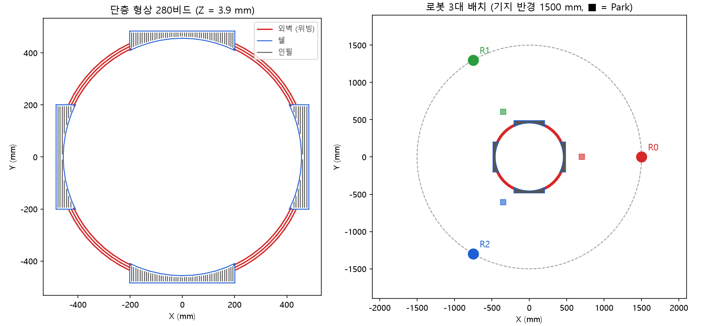
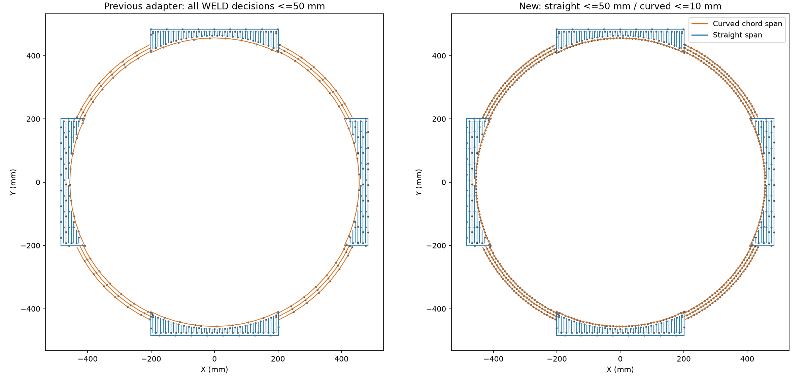
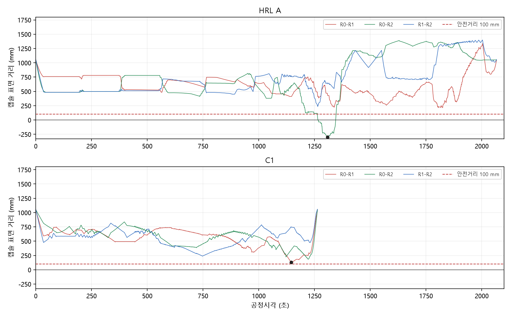
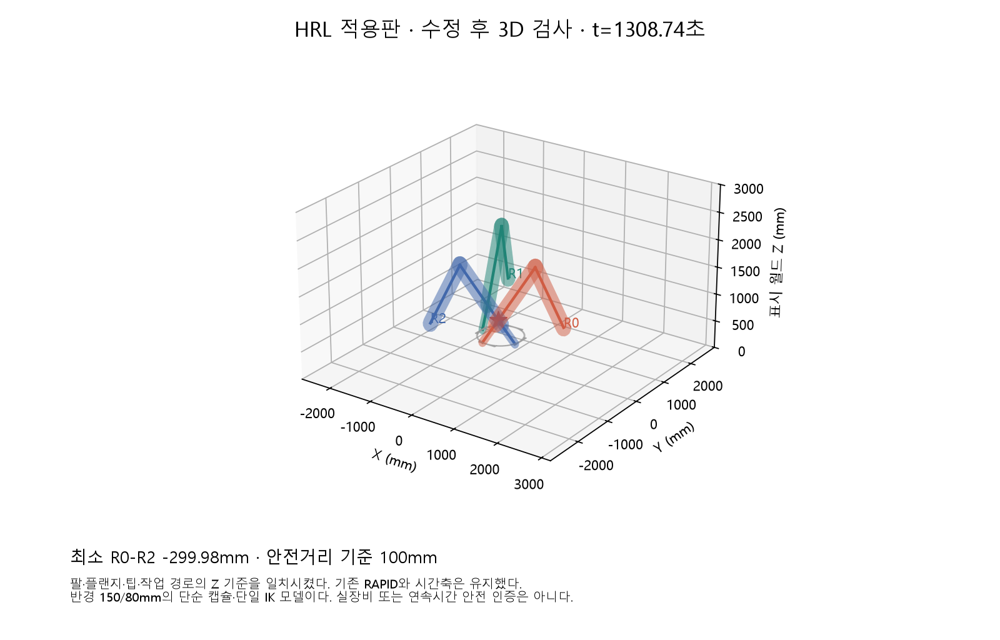

# 다중 로봇 WAAM 단층 적층에 계층적 강화학습 적용과 3D 검증

*Applying hierarchical RL to multi-robot WAAM layer scheduling on an industrial part geometry, and auditing the result with a common 3D collision check.*

로봇 3대가 대형 금속 적층(WAAM) 부품의 한 층을 나눠 쌓을 때, **어느 로봇이 어떤 비드를 언제 쌓을지** 정하는 문제입니다. 학위논문의 계층적 강화학습(HRL)을 한국생산기술연구원(생기원) 실제 부품 형상에 옮기고, 로봇 프로그램(ABB RAPID)으로 출력한 뒤, CP-SAT 기반 방법과 **같은 3D 충돌 감사**로 비교했습니다.

## 요약

- 원본 HRL이 실제 공정으로 넘어갈 때 맞지 않는 부분 **16개**를 논문·코드·공정 자료 근거와 함께 정리했습니다.
- 원본 HRL을 생기원 형상(280비드, 곡선·위빙 포함)에 이식했습니다. 비드 속도를 반영하려고 로봇별 독립 시간 환경을 만들었고, 원본의 2D 충돌식을 이식했으며, 결과를 RAPID로 출력했습니다.
- 학습 중 2D 충돌 모델로는 완주했지만, **공통 3D 감사에서는 불합격**했습니다(최소 표면 거리 −299.98 mm). 같은 감사에서 CP-SAT C1은 위반 0으로 통과했고 공정시간도 1,263초로 HRL(2,066초)보다 짧았습니다.
- 원인은 이식 과정에서 충돌 검사를 **적층 자세로만 좁힌 결정**이었습니다. 위반은 모두 이 조건 때문에 학습 중 검사에서 빠진, 이송·대기 중인 로봇이 낀 구간에서 나왔습니다. 학습용 충돌 모델과 최종 검증 모델이 다르면 생기는 위험을 실제로 확인한 사례입니다.



## 1. 문제

- **형상.** 생기원 제공 부품의 첫 층(Z = 3.9 mm), 약 968×968 mm입니다. 외벽 96비드(위빙), 쉘 62비드, 인필 122비드로 모두 280비드입니다. 데이터는 [`data/kitech_v4_layer1.csv`](data/kitech_v4_layer1.csv)에 있습니다.
- **로봇.** ABB 로봇 3대를 반경 1,500 mm 원 위에 120° 간격으로 배치했습니다. 작업 전후에는 Park 자세(기지에서 중심 방향 800 mm, 높이 1,400 mm)에 있습니다.
- **속도.** 적층 6.67 mm/s, 위빙 2.0 mm/s, 이송 41.67 mm/s입니다. 비드 사이 이동은 적층면 +10 mm 높이로 합니다.
- **목표.** 충돌 없이 마지막 로봇이 Park로 돌아오는 시각(makespan)을 줄이는 것입니다.

## 2. 원본 HRL과 실제 공정 사이의 간극

원본 HRL(안정민, 석사학위논문, 2026.02)은 상위 PPO가 비드를 로봇에 배정하고, 하위 PPO가 50 mm마다 로봇별 이동·대기를 정하는 구조입니다. 충돌은 2D 모델(기지→TCP 선분 + 500×300 mm 박스)로 판정하고, 충돌하는 이동은 환경이 막으며 벌점을 줍니다.

실제 공정 기준으로 보면 다음 같은 간극이 있습니다. 전체 16개와 근거는 [`docs/hrl-limitations.md`](docs/hrl-limitations.md)에 있습니다.

| 분류 | 대표 항목 |
|---|---|
| 형상 표현 | 모든 비드를 Y축 직선으로 가정. 곡선·쉘·위빙을 표현하지 못함 |
| 공정 규칙 | 이웃 비드 방향 교번(Bi-direction)을 보장하지 못함. 비드 중간 정지 허용. 열 영향 없음 |
| 로봇·동작 | 2D 충돌 모델. 비드 사이 순간이동. TCP가 기지 좌표에서 시작. 모든 동작이 같은 속도 |
| 결과·운용 | 시간이 스텝 수. 로봇 프로그램 출력과 검증 없음. 형상마다 재학습, 확률적 정책 |

## 3. 한 일

| 작업 | 내용 | 코드 |
|---|---|---|
| 원본식 충돌 이식 | 원본의 XY 박스·선분 충돌식을 새 형상의 경로에 적용 | [`S36_legacy_xy_collision.py`](src/hrl/S36_legacy_xy_collision.py) |
| 작업 단위 정의 | 끝점이 이어진 비드를 연결 경로 138개로 묶음 | [`S37_task_granularity.py`](src/hrl/S37_task_granularity.py) |
| 판단점 환경 | 연결 경로를 판단점 큐로 바꾸고 논문식 이동·대기 환경 구성 | [`S38_hrl_pointwise.py`](src/hrl/S38_hrl_pointwise.py) |
| 계층 학습 | 상위 배정 PPO와 하위 이동·대기 PPO를 메타 반복으로 결합 | [`S39_hrl_paper_training.py`](src/hrl/S39_hrl_paper_training.py) |
| 독립 시간 환경 | 비드마다 속도가 달라도 되도록 로봇별 독립 시간 진행. 곡선은 10 mm, 직선은 50 mm 판단점 | [`S42_hrl_event_time.py`](src/hrl/S42_hrl_event_time.py) |
| 로봇 프로그램 출력 | 이동·대기 결과를 원래 꼭짓점을 보존한 로봇별 RAPID로 변환 | [`S40_hrl_pointwise_rapid.py`](src/hrl/S40_hrl_pointwise_rapid.py) |
| 공통 지표 | 계획 일정과 RAPID 명령 시간에서 대기·가동률을 같은 식으로 계산 | [`S41_execution_metrics.py`](src/hrl/S41_execution_metrics.py) |
| 실행·재현 | 입력·소스 해시·체크포인트를 보존하며 학습과 평가 실행 | [`hrl_event_run.py`](src/tools/hrl_event_run.py) |
| 공통 3D 감사 | HRL 결과와 CP-SAT C1 결과를 같은 좌표·기하·시간 조건으로 재검사. C1은 보존된 일정에서 RAPID를 재생성해 시작·종료 시각 오차 0초로 복원 | 원 저장소 |



*왼쪽은 모든 구간을 50 mm로 나눈 기존 방식이고, 오른쪽은 곡선만 10 mm로 촘촘하게 나눈 적용본입니다.*

## 4. 결과

공통 3D 감사 조건은 다음과 같습니다.

- 팔 캡슐 반경 150 mm, 토치 캡슐 반경 80 mm, 토치 기울기 36°입니다.
- RAPID 명령을 누적 시간으로 읽어 접근, 대기, 이송, Park까지 0.01초 간격으로 검사합니다.
- 표면 거리 100 mm 미만은 근접, 0 mm 이하는 접촉·겹침으로 판정합니다.

| 지표 | HRL 적용본 (버전 A) | CP-SAT C1 |
|---|---:|---:|
| 최종 Park 복귀 시각 | 2,066.35초 | 1,263.35초 |
| 최소 캡슐 표면 거리 | −299.98 mm | 128.81 mm |
| 100 mm 미만 표본 (로봇 쌍·시각) | 8,384 | 0 |
| 그중 접촉·겹침 표본 | 7,952 | 0 |
| 연속 위반 구간 | 1개 (1,262.8~1,346.6초, R0–R2) | 0 |
| IK 실패 | 0 | 0 |
| 판정 | 불합격 | 통과 |





*HRL 최소거리 시각(1,308.74초)의 자세입니다. R0과 R1은 이송 중이고 R2는 적층 중입니다.*

HRL 학습은 4시간 22분 걸렸고(메타 100회), 100회 중 36회 완주했습니다. 위 결과는 76번째 메타에서 관측한 최선 경로입니다. 저장된 정책을 결정론적으로 다시 돌리면 70.33%에서 멈춰 완주하지 못합니다. 즉 이 결과는 **정책이 재현하는 성능이 아니라 학습 중 한 번 관측한 경로**입니다.

## 5. 왜 실패했나

원본 HRL은 모든 자세에서 2D 충돌을 검사합니다. 이식하면서 비드 사이 이송(적층면 +10 mm)을 추가했는데, 높이가 다른 이송 자세를 XY 평면에 투영하면 실제로는 괜찮은 이동까지 막히는 문제가 생겼습니다. 그래서 **두 로봇의 TCP가 모두 적층면에 있을 때만** 2D 검사를 하도록 범위를 좁혔습니다. 원본 논문의 규칙이 아니라 이식 과정에서 추가한 조건입니다.

저장된 행동을 다시 재생해 확인한 결과는 다음과 같습니다.

- 3D 감사의 위반 표본 8,384개는 **모두 이 조건 때문에 학습 중 검사에서 빠진 시각**이었습니다. 적층면 밖에 있는 로봇(이송·대기 중)이 낀 쌍입니다.
- 높이 조건을 뺀 원본식 2D 검사를 같은 시각에 적용하면 위험으로 표시됩니다. 대표 시각에서는 실제 로봇 팔 메시끼리의 교차도 확인했습니다.
- 다만 조건만 없애면 학습·완주·안전이 모두 해결된다는 뜻은 아닙니다. 원래 이 조건이 막으려던 과잉 차단 문제가 다시 생깁니다.

정리하면 두 가지를 배웠습니다.

1. **학습 환경의 안전 판정과 최종 검증 모델이 같아야 합니다.** 학습 중 "충돌 0"은 학습 모델 기준일 뿐입니다.
2. **완주와 안전은 따로 확인해야 합니다.** 이 저장소의 결과 보고는 완주, 시간, 3D 감사를 분리해서 기록합니다.

이 결과는 **이 이식판과 C1의 비교**이고, HRL 방법론 일반의 실패로 해석하지 않습니다.

방법별 차이 전체는 [`docs/method-comparison.md`](docs/method-comparison.md)에 있습니다. 1,263초와 2,066초의 차이에는 방법 차이 외에 자유도 차이도 섞여 있습니다. C1은 비드 방향을 뒤집고 연결 경로를 나눌 수 있지만, 버전 A는 그렇게 하지 못합니다.

## 6. 추가 분석: 인필 방향 교번

생기원 공정 규칙에서는 이웃한 비드의 적층 방향이 서로 반대여야 합니다(Bi-direction). 비드 시작·끝점의 높이 차이를 서로 상쇄하기 위한 규칙이라 공간적인 조건이고, 어느 로봇이 언제 쌓는지와는 무관합니다.

C1은 비드 방향을 자유롭게 탐색하므로 이 규칙을 지키는지 확인했습니다.

| 구분 | 이웃 인필 쌍 |
|---|---:|
| 원래 방향이 서로 반대인 이웃 쌍 | 108 |
| C1에서도 반대 방향 유지 | 97 |
| C1에서 같은 방향이 됨 | 11 |
| └ 다른 로봇이 쌓음 | 6 |
| └ 같은 로봇이 떨어진 시각에 쌓음 | 3 |
| └ 같은 로봇이 연달아 쌓음 | 2 |

움직임만 보면 연달아 쌓은 2쌍만 지그재그가 깨진 것으로 볼 수 있습니다. 하지만 공간 규칙 기준으로는 11쌍 모두 위반입니다. 방향 규칙을 제약으로 넣어야 한다는 근거가 됩니다. 시간순 재생은 [`docs/infill_direction_c1.html`](docs/infill_direction_c1.html)을 내려받아 브라우저로 열면 볼 수 있습니다.

## 7. 한계와 다음 단계

- **단일 실행 비교입니다.** HRL은 seed 1개, C1은 선택 해 1개입니다. 방법 전체의 우열이나 통계적 차이를 주장하지 않습니다.
- **3D 감사는 대리 모델입니다.** 단순 캡슐과 단일 IK 해를 씁니다. 실제 로봇 메시, 연속시간 간섭, 실장비 동작을 검증한 결과가 아니며, 시간도 모델상의 시간입니다.
- **공정한 비교 조건을 다시 맞출 예정입니다.** 형상 적응만 하고 방법은 원본대로 둔 HRL(버전 B)과, 방향 고정·연결 경로 유지 조건의 C1을 비교합니다.
- **공정 규칙을 반영합니다.** 비드 단위 할당과 이웃 비드 방향 교번 제약을 넣습니다.
- **세 방법을 비교합니다.** 선행연구의 Top-k% 휴리스틱(Li et al., *Virtual and Physical Prototyping*, 2024)을 재구현해 CP-SAT, HRL, Top-k 셋을 같은 감사로 비교합니다.

## 저장소 구성

```
data/       생기원 단층 형상 CSV (280비드)
src/hrl/    HRL 적용 모듈 스냅샷
src/tools/  학습·평가 실행기
tests/      HRL 모듈 테스트
docs/       한계점, 방법 비교, 인필 방향 재생
figures/    README 그림
```

`src/`는 **코드 스냅샷**이라 이 저장소만으로는 실행되지 않습니다. 비드 로딩, RAPID 기본 출력, 3D 감사 모듈을 과제 공동 파이프라인에서 불러 씁니다. 자세한 의존 관계는 [`src/README.md`](src/README.md)에 있습니다.

## 출처와 감사의 말

- 원본 HRL: 안정민, 석사학위논문 (2026.02). 원본 코드는 포함하지 않았습니다.
- 형상 데이터와 공정 조건: 한국생산기술연구원 과제 제공 자료입니다. 공개 허락을 받고 실었습니다.
- 서울과학기술대학교 SMI 연구실에서 수행했습니다.
